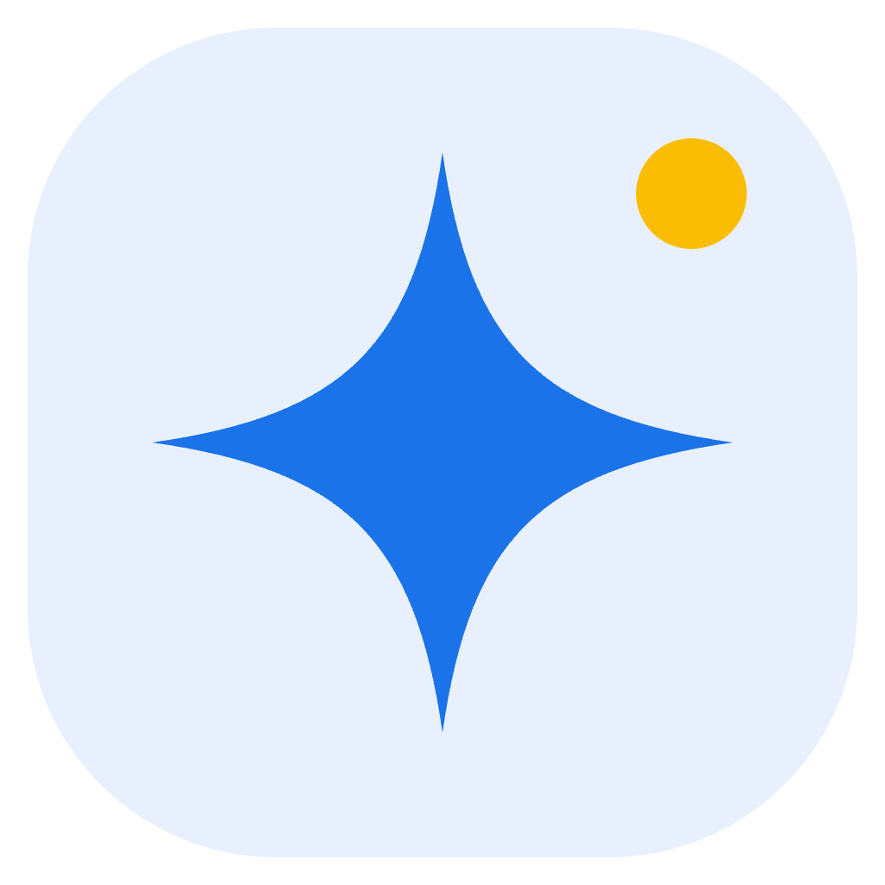

<p align="center">
  
</p>

<h1 align="center">Star Browser</h1>

<p align="center">独立浏览环境 · 本地代理 · 多环境工作台</p>

<p align="center">
  <a href="https://github.com/LcodeCoder/Star-Browser/releases/tag/0.14.0">下载 0.14.0</a> ·
  <a href="macos/docs/capabilities.md">功能与范围</a> ·
  <a href="macos/docs/release-0.14.0.md">版本说明</a> ·
  <a href="macos/docs/verification.md">验证记录</a>
</p>

Star Browser 是面向日常多环境工作的桌面浏览器，支持 **Windows x64** 和 **macOS Apple Silicon（arm64）**。在统一工作台中管理独立浏览环境、代理、标签、备份和本地任务，使用 Electron 内置 Chromium，也可启动独立的本机 Chrome。

## 下载

当前版本：**0.14.0**。

| 平台 | 架构 | 安装包 |
| --- | --- | --- |
| Windows | x64 | [下载 EXE](https://github.com/LcodeCoder/Star-Browser/releases/download/0.14.0/Star-Browser-0.14.0-win-x64.exe) |
| macOS | Apple Silicon / arm64 | [下载 DMG](https://github.com/LcodeCoder/Star-Browser/releases/download/0.14.0/Star-Browser-0.14.0-mac-arm64.dmg) |

macOS 安装包采用 ad hoc 签名，尚未进行 Developer ID 签名与公证；Windows 安装包未签名。Windows 已完成 GitHub Actions 构建与回归检查，用户设备上的安装与运行验收仍需实际验证。

## 功能

- **独立浏览环境**：独立会话和数据目录，支持配置导入导出、分组、标签、搜索、置顶、归档与批量操作。
- **代理管理**：支持 HTTP、HTTPS、SOCKS5 和鉴权代理，提供代理库、批量录入、检测、进度显示及取消操作。
- **指纹配置与检查**：管理语言、时区、屏幕、UA / Client Hints 和手动 WebGL 配置，覆盖页面及 Dedicated / Shared / Service Worker，提供实际差异报告与 BrowserScan / BrowserLeaks 检测入口。
- **浏览器日常操作**：多标签、固定、静音、休眠与恢复，以及书签、独立历史、下载管理、站点权限和当前标签 DevTools。
- **本地工作流**：加密环境备份与恢复、扩展管理、窗口同步、本地任务编排、任务导入导出和带密钥的本地 API。
- **浅色与深色界面**：工作台和浏览器共享主题，深色界面采用分层深蓝配色，网页画布保留正常背景，支持键盘操作与窄窗口布局。

具体实现、验证范围及待完善能力见 [功能与范围](macos/docs/capabilities.md)。

## 本地运行

安装 Node.js 和 npm 后，在仓库目录执行：

```sh
cd macos
npm ci
npm start
```

当前工程统一位于 `macos/`，Windows 与 macOS 共用源码。工作台使用 React、Radix UI、cmdk 和 Lucide，界面资源在构建时打包，运行时不依赖在线组件服务。

## 打包

在 `macos/` 目录运行对应命令，产物输出到 `macos/dist/`。

| 目标 | 命令 | 产物 |
| --- | --- | --- |
| macOS Apple Silicon | `npm run build:mac` | arm64 DMG / ZIP |
| Windows x64 | `npm run build:win` | x64 EXE / ZIP |
| macOS Intel | `npm run build:mac:intel` | x64 DMG / ZIP |
| Windows ARM64 | `npm run build:win:arm64` | arm64 EXE / ZIP |

Intel Mac 与 Windows ARM64 提供构建入口，兼容性需要在对应设备上验证。macOS 打包需在 macOS 上执行。

## 验证

```sh
npm test
npm run test:workbench-browser
npm run test:experience
npm run test:diagnostics
npm run test:cookie-workspace
npm run test:proxy-workspace
npm run test:e2e
```

完成 macOS arm64 打包后，可运行 `npm run test:package` 检查实际打包应用；Windows x64 在 macOS 上可交叉构建，需在 Windows 设备上再完成安装运行检查。测试使用临时用户目录和本地服务，避免读取日常浏览数据；实际结果与各版本证据见 [验证记录](macos/docs/verification.md)。

## 能力边界

指纹处理使用 JavaScript 和 CDP，覆盖页面、iframe 与各类 Worker 的可配置读值，默认保留原生图形与音频信号。内置 Electron 的跨进程 iframe 原生像素比/CSS 仍有已验证限制；独立 Chrome 已对齐原生像素比与 CSS 分辨率，自定义屏幕尺寸 CSS 仍有差异，具体覆盖与证据见 [JS/CDP 验证记录](macos/docs/js-cdp-verification.md)。此工程尚不提供内核级反检测保证、远程团队服务、云浏览器或代理购买服务；远程检测网站的结果只代表特定机器、配置及当次观测，不作为所有网站的检测保证。

原生 CPU/RAM/内存请求头及屏幕策略的小范围 Chromium 补丁、版本锁和验收工具见 [原生内核准备](kernel/README.md)。当前没有通过运行验收的定制内核二进制，内核 P0 尚未完成。

## 项目文档

- [0.14.0 版本说明](macos/docs/release-0.14.0.md)
- [功能与实际范围](macos/docs/capabilities.md)
- [验证记录](macos/docs/verification.md)
- [工作台设计](macos/docs/workbench-design-0.13.md)
- [迭代计划](macos/docs/iteration-plan.md)
- [工程说明](macos/README.md)
- [第三方声明](macos/THIRD_PARTY_NOTICES.md)

源码最初基于用户提供的 Windows 安装包资源，通过项目内 baoyu-electron-extract 技能提取与校验；外部安装包和提取目录已从当前工作区清理，版本库只维护可构建源码；`npm run verify:source` 在有本机原始 asar 与安装包校验记录时执行逐文件溯源；证据不存在时只报告源码语法检查，不伪造溯源结论。
