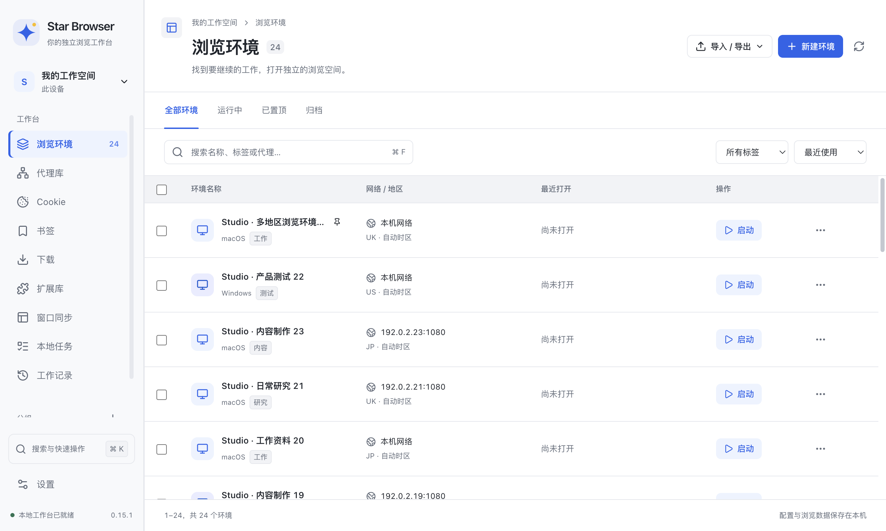
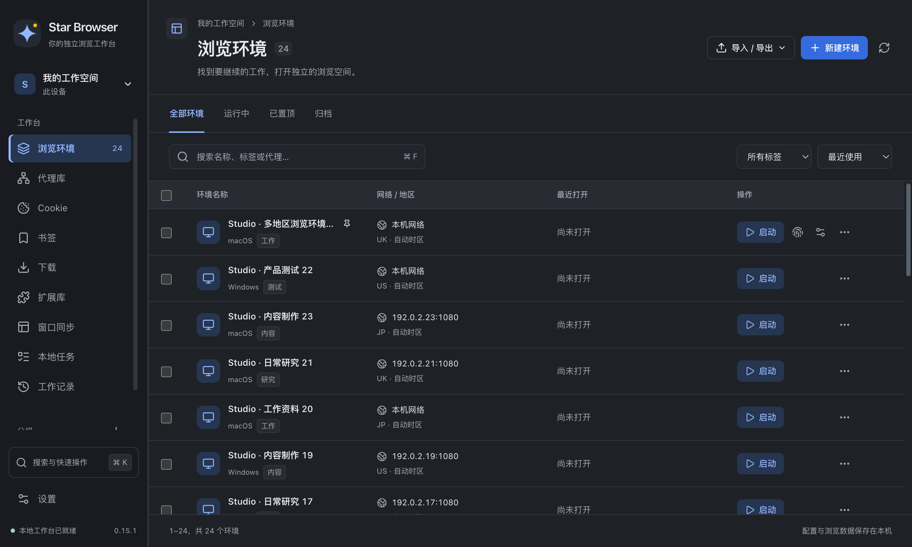

# Star Browser 0.15.1

## 浏览环境布局

环境表格之前混用了名称列剩余宽度、网络列百分比和最近打开 / 操作列固定宽度，造成字段间距失衡。这次四个内容列改为等宽，统一左右留白，表头、内容与操作按钮对齐；选择框保留窄列并修复窄窗表头裁切。

长名称使用省略号并保留完整名称提示，置顶标记继续可见。500–1440px 窗口、详情展开和浅深主题下，剩余可见内容列仍平均分配空间。

## 原生一致显示

新环境默认采用“原生一致”，使用真实显示器参数；已有自定义屏幕 / DPR 的配置继续保留。编辑器支持切换显示策略与编辑备用自定义参数，缺失字段错误会展开并定位，同时保留用户选择的模式。

原生一致模式清除设备指标模拟，保留 screen getter、devicePixelRatio 和 CSS 引擎。网页诊断同时读取 matchMedia 与实际 @media 样式，原生信号与配置匹配分开显示，CSP 阻止时如实显示未读取。独立 Chrome 的原生一致模式使用浏览器默认显示缩放。

这次验证的是原生参数在各上下文中的一致性。任意自定义屏幕 / DPR 仍有底层限制：内置 Electron 的 OOPIF 原生 DPR/CSS，以及独立 Chrome 的 OOPIF 自定义屏幕尺寸 CSS 仍在报告中标为 partial。站点隔离保持开启，物理多显示器切换与系统睡眠未测试；定制 Chromium 编译与运行验收仍未完成。详见 [JS/CDP 验证](js-cdp-verification.md)。

## 本机验证

2026-10-13（America/Los_Angeles），macOS arm64 源码运行：

| 验证 | 结果 |
| --- | --- |
| Node 单元回归 | 102 项通过 |
| 原生 Electron 显示 / 真实 CSS / 生命周期 | 9 项通过 |
| 独立 Chrome 自定义缩放与原生一致显示 | 7 项通过，整份报告保留 partial |
| 页面、Worker 与本机 Chrome 指纹回归 | 17 项通过 |
| 严格上下文与生命周期 | 14 项通过、1 项部分 |
| 环境编辑器 | 10 项通过 |
| 工作台与浏览器交互 | 11 项通过 |
| 全工作页布局、对比度与交互 | 12 项通过 |
| 浏览器设置 | 12 项通过 |
| 标签与休眠恢复 | 8 项通过 |
| 权限隔离 | 3 项通过 |
| 原生内存请求头 | 5 项通过 |
| 运行时源码语法 | 53 个 JavaScript 文件通过 |
| 环境表格测量 | 7 种宽度、3 种详情布局、深色紧凑模式通过 |

表格的可见内容列最多相差 0.016px（亚像素舍入），选择框、单元格、操作区和页面均无横向溢出。1280px 普通窗口的四列均为 252.75px，500px 窗口的两个可见内容列均为 190.5px。

原生显示专项使用独立 stock Electron 对照，检查六类 frame 首段脚本与真实 CSS、19 种 resolution 查询、缩放 / 复原、MQL 事件、导航、重载、DevTools、双环境隔离、标签休眠、关闭重开与应用重启。报告与截图位于 test-results/。GitHub Actions 新增原生显示专项，Windows 的运行结论需要对应提交的 Windows 作业证据。

外部 asar 原始提取证据已在之前清理；溯源工具明确返回 source-unavailable，当前语法通过不冒充原始文件校验。

## 安装包

Mac arm64 DMG / ZIP 与 Windows x64 EXE / ZIP 已在本机构建，四个文件通过完整性、二进制架构、应用版本和全部 src/ 资源匹配检查。校验清单为 SHA256SUMS-0.15.1.txt，产物位于 macos/dist/。Mac arm64 实际打包应用完成 13 项启动与功能检查，另外 12 项打包界面体验检查通过。Windows 交叉构建不作为 Windows 实际运行证据，后续需核对本提交的 Windows CI 结果。本版本尚未上传到 GitHub Release。

macOS 使用 ad hoc 签名，未进行 Developer ID 签名与公证；Windows 安装包未签名。
