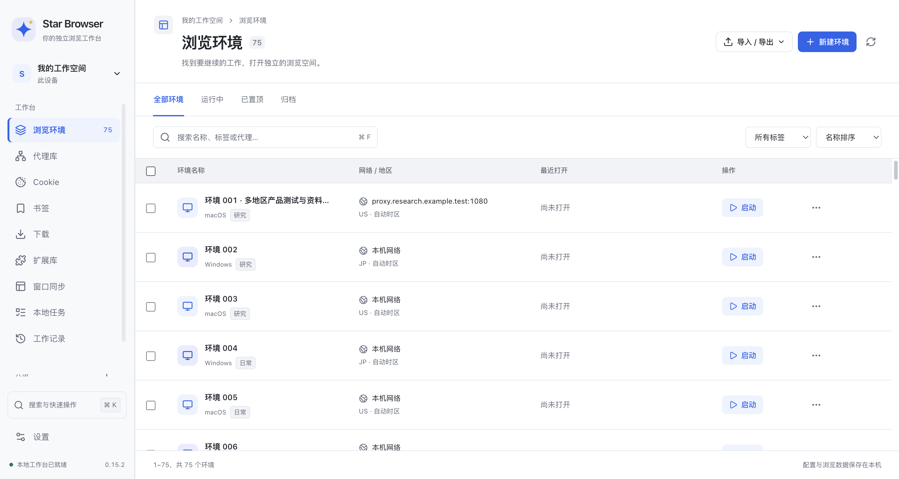
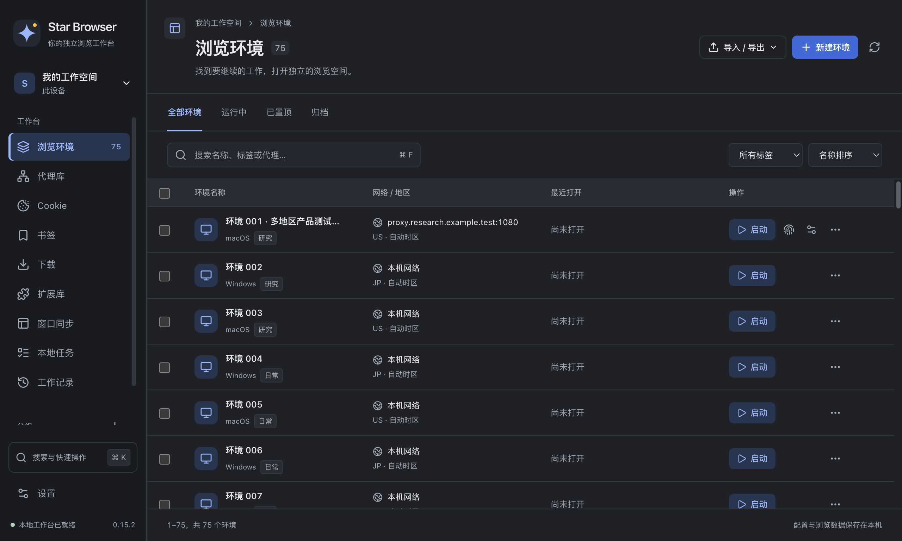

# Star Browser 0.15.2

## 浏览环境选择和分页

表格部分选中时显示系统原生半选状态。全选和取消选择只作用于当前页，保留其他页的选择；排序也保留选择。搜索、分组或标签改变时清除旧选择，防止批量操作涉及已离开当前筛选的环境。

删除最后一页全部环境后回到有效页，自动清除失效选择。翻页回到列表顶部。行的无障碍选择状态与复选框一致，四个内容列继续等宽。

## 网页初始布局和开发者工具

新建或唤醒前台标签时，在挂载 webview 前设置可见布局，使初始 guest 尺寸来自前台布局。原生显示回归继续检查六类 frame 的首段脚本 DPR、真实 @media 样式和 120×30 CSS 像素矩形，并增加重复休眠与唤醒检查。

开发者工具回归增加连续六次打开、重载和关闭，以及打开 DevTools 时关闭前台标签的检查。测试记录进程退出、renderer 退出与 DevTools 生命周期；出现原生崩溃时保存本地转储，帮助定位 Windows 上此前出现过的连接关闭问题。

代理、任务、书签和批量编辑在界面更新后立即定位错误字段；导入错误会选中实际错误行，继续编辑保留原选择。书签写入失败后焦点保持在弹窗内，支持快捷键重试。

调试目标在导航中被替换时立即结束旧会话的等待，仅取消该会话的命令，其他环境的请求继续执行。显示回归重新连接当前目标，并保留首段脚本和真实 CSS 的全部断言。

编辑器专项在清理测试窗口前保存失败报告，防止未保存草稿的退出保护阻塞清理。CI 为桌面作业和专项步骤设置超时，超时仍属于失败。

## 本机验证

2026-10-14（America/Los_Angeles），macOS arm64：

| 验证 | 结果 |
| --- | --- |
| Node 单元回归 | 105 项通过 |
| 运行时源码语法 | 53 个 JavaScript 文件通过 |
| 浏览环境选择、分页、筛选与 500–1440px 布局 | 7 项通过 |
| 原生显示、真正 OOPIF、CSS 与生命周期 | 9 项通过 |
| 连续休眠和唤醒额外验证 | 20 次通过 |
| 工作台、浏览器与重复 DevTools 切换 | 12 项通过 |
| 标签操作与休眠保护 | 8 项通过 |
| 批量编辑与错误恢复 | 8 项通过 |
| 代理、任务与书签编辑器 | 11 项通过 |
| 代理导入、分配与磁盘错误恢复 | 7 项通过 |
| 0.15.2 Mac 打包应用启动与功能检查 | 13 项通过 |

证据保存在 `macos/test-results/`。四个安装包已通过完整性、目标架构、应用版本和全部 `src/` 资源匹配检查，SHA-256 清单位于 `macos/dist/SHA256SUMS-0.15.2.txt`。Windows 的结论以本版本对应提交的 Windows CI 为准；Mac 上的交叉构建不作为 Windows 运行证据。

## 内核进度与范围

完整 Xcode 已在本机可用，固定 Chromium 155.0.8059.40 的源码与依赖准备仍在进行。小范围 OOPIF 屏幕参数补丁尚未完成完整 Chromium 编译和实际二进制运行验收，`p0Complete` 仍为 `false`。本版本使用 Electron 内置 Chromium，不能把上述原生显示一致性回归解释为自定义屏幕 / DPR 的内核问题已经解决。

本版本保留原生一致和自定义显示配置。没有增加云服务，也不承诺对任意网站的指纹检测或账号风控都有效。

## 安装包

Mac arm64 DMG / ZIP 与 Windows x64 EXE / ZIP 已构建并通过完整性和源码匹配校验，Mac 打包应用完成 13 项功能检查。产物位于 `macos/dist/`；本版本尚未上传 GitHub Release。macOS 使用 ad hoc 签名，未进行 Developer ID 签名与公证；Windows 安装包未签名。
